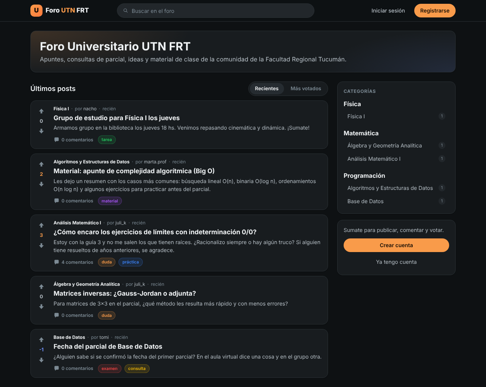
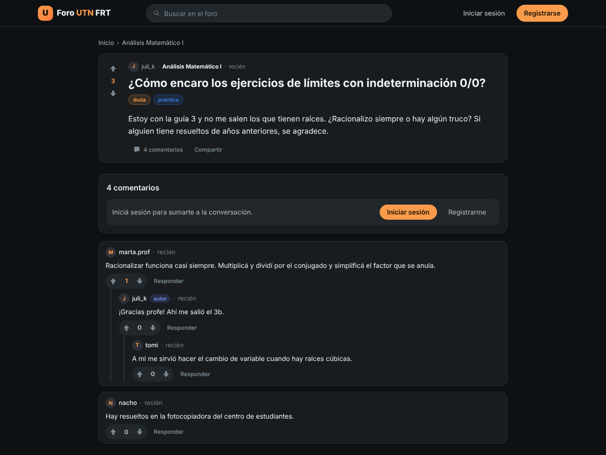
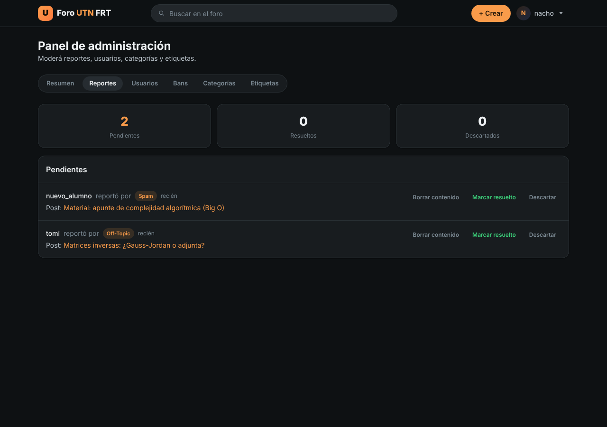

<div align="center">

# 🎓 Foro Universitario — UTN FRT

**Foro académico para la comunidad de la Facultad Regional Tucumán**  
Ideas · apuntes · consultas de parcial · material de clase

[](https://nodejs.org/)
[](https://expressjs.com/)
[](https://www.mysql.com/)
[](https://zod.dev/)
[](https://jwt.io/)
[](#-cómo-probarlo)
[](LICENSE)

**Status:** FASE 1 (seguridad) ✅ · Auditoría + FASE 2 (vista Reddit) ✅

</div>

---

<div align="center">

### ✨ Por qué este foro

|  |  |
|:--:|:--:|
| 🔐 **Seguridad primero** | Zod en cada ruta · helmet · JWT + invalidación de sesión · logs seguros |
| 💬 **Discusión real** | Posts, hilos de comentarios, votos tipo karma, tags y categorías |
| 🛡 **Moderación** | Reportes, bans temporales/permanentes, panel de admin |
| 🚀 **Sin frameworks en el front** | HTML/CSS/JS vanilla — fácil de leer y de llevar a producción |

</div>

---

## 📸 Capturas

<div align="center">
  
  <br><br>
  
  
</div>

---

## ✨ Características

| Área | Qué incluye |
|------|-------------|
| **Cuenta** | Registro, login (JWT), recuperación de contraseña por email, perfil con bio/avatar, baja de cuenta |
| **Contenido** | Posts con categoría (jerárquica) e imagen, comentarios anidados, tags |
| **Votos** | Upvote / downvote en posts y comentarios (karma), también desde el listado |
| **Búsqueda** | Filtros por categoría y tag, búsqueda por texto, orden (recientes / votos), paginación |
| **Moderación** | Reportes (spam, abuso, off-topic…), bans, panel de admin |
| **Roles** | `admin` · `profesor` · `alumno` con middleware de permisos |
| **Admin** | Dashboard, usuarios, categorías, tags, reportes y bans |

---

## 🛠 Stack

| Capa | Tecnología |
|------|------------|
| Backend | **Node.js** + **Express 5** (CommonJS) |
| DB | **MySQL** (`mysql2`) |
| Validación | **Zod** (body, query y params) |
| Auth | **JWT** + `token_version` (invalida sesiones al cambiar contraseña) |
| Front | HTML / CSS / JS **vanilla** + Tailwind compilado |
| Seguridad | `helmet` · `compression` · `cors` · `express-rate-limit` · `bcrypt` |
| Tests | **Jest** |
| Email | `nodemailer` (SMTP) |

---

## 🚀 Quick start

```bash
# 1. Clonar
git clone https://github.com/Fumacio/Proyecto-foro-universitario.git
cd Proyecto-foro-universitario
npm install

# 2. Base de datos (MySQL o MariaDB prendido; si usás XAMPP, Start en MySQL)
mysql -u root -p -e "source Back/db/schema.sql"
mysql -u root -p -e "source Back/db/seed.sql"

# 3. Entorno
cp .env.example .env
# → editá .env (DB_*, JWT_SECRET, SMTP_*)
# JWT_SECRET: node -e "console.log(require('crypto').randomBytes(48).toString('hex'))"

# 4. Arrancar
npm run dev
# → http://localhost:3000

# 5. Primer admin: registrate desde la web y después
npm run make-admin -- tu@email.com

# 6. Tests
npm test
```

**¿Ya tenías la base creada con una versión anterior?** Corré las migraciones una vez, en orden:

```bash
mysql -u root -p -e "source Back/db/migrations/001_bans_banned_by_set_null.sql"
mysql -u root -p -e "source Back/db/migrations/002_utf8mb4.sql"
```

La `002` pasa las tablas a `utf8mb4` (sin eso, un post con emoji da error en servidores en latin1, como XAMPP)
y arregla las categorías y etiquetas que se ven como "Física". Si tu base ya estaba bien, no cambia nada.

**¿Windows?** Los comandos andan igual en la terminal de VS Code (PowerShell). Se usa `source` en vez de
`mysql ... < archivo.sql` porque PowerShell no acepta `<`. Si `mysql` no se reconoce y usás XAMPP,
reemplazalo por `C:\xampp\mysql\bin\mysql.exe`. Con XAMPP el root no tiene contraseña: cuando la pida, apretá Enter.

**Estilos:** el front usa Tailwind compilado en `Front/css/tailwind.css` (ya viene generado).
Si agregás clases nuevas de Tailwind en el HTML/JS, regeneralo con:

```bash
npm run build:css   # o npm run watch:css mientras desarrollás
```

### Variables de entorno

| Variable | Descripción |
|----------|-------------|
| `PORT` | Puerto del server (default `3000`) |
| `FRONTEND_URL` | Origen CORS (default `http://localhost:3000`) |
| `NODE_ENV` | `development` \| `production` |
| `DB_HOST` / `DB_USER` / `DB_PASS` / `DB_NAME` | MySQL |
| `JWT_SECRET` | Firme de tokens — **fuerte y nunca a Git** |
| `SMTP_*` | Recuperación de contraseñas |
| `TRUST_PROXY` | Opcional. `1` si corre detrás de un proxy/hosting (para que el rate limit vea la IP real) |
| `RATE_LIMIT_MAX` | Opcional. Requests por IP cada 15 min en `/api` (default `1000`) |

> `.env` está en `.gitignore`; solo se versiona `.env.example`.  
> El server carga el `.env` con path absoluto: funciona aunque lo lances desde otra carpeta.

---

## 📁 Estructura

```
├── Back/
│   ├── server.js           # Express · helmet · CORS · rate limits · rutas
│   ├── controllers/        # Lógica de endpoints
│   ├── routes/             # Rutas + validación Zod
│   ├── middleware/         # auth · ban · role · validate · upload · errorHandler
│   ├── schemas/            # Schemas Zod (auth, posts, comments, …)
│   ├── utils/              # errores tipados · mailer · helpers
│   ├── db/                 # connection · schema.sql · seed.sql · migrations/
│   ├── scripts/            # make-admin
│   └── tests/              # Jest
├── Front/
│   ├── *.html              # index · posts · login · admin · profile…
│   ├── js/                 # api (helpers + UI compartida) · auth · nav · index · post(s) · profile · admin
│   └── css/                # theme.css (tema propio) · tailwind.css (generado)
├── .env.example
└── package.json
```

---

## 🔌 API

Base: `/api`

| Método | Ruta | Auth | Descripción |
|--------|------|------|-------------|
| POST | `/auth/register` · `/auth/login` | — | Cuenta / sesión |
| POST | `/auth/forgot-password` · `/reset-password` | — | Recuperar contraseña |
| GET/POST | `/posts` | parcial | Listar / crear posts |
| GET/POST | `/posts/:postId/comments` | parcial | Comentarios |
| PUT | `/posts/:id/vote` · `/comments/:id/vote` | ✅ | Votar |
| GET/POST | `/categories` · `/tags` | admin (escritura) | Taxonomía |
| POST | `/reports` | ✅ | Reportar |
| GET/POST | `/bans` | admin | Bans |
| GET | `/admin/dashboard` | admin | Métricas |

**Errores:** `{ "error": "…" }` + status correcto (400 · 401 · 403 · 404 · 409 · 500).  
En dev, los `AppError` pueden traer `details` (campo → mensaje Zod).

---

## 🔒 Seguridad

### ✅ Aplicado (FASE 1)

- **Zod** en los 10 routers (body, query, params)
- **helmet** + **compression**
- **AppError** / `errorHandler` global
- **JWT_SECRET** rotado · `.env` fuera de Git · `.env.example` plantilla
- **Logs seguros** en producción (sin stack ni queries)
- Rate limiting (general + estricto en auth, solo cuenta intentos fallidos)
- CORS → `FRONTEND_URL`
- **`token_version`**: cambiar o resetear la contraseña cierra las otras sesiones
- El **rol se lee de la DB** en cada request (degradar a un admin aplica al instante)
- Escapado de todo lo que se pinta en el front (incluye atributos); `image_url` solo acepta imágenes subidas al server
- **bcrypt** (10 rounds) · uploads seguros · middleware de ban
- Front: **auto-logout** ante 401 de token inválido

### ⏳ Pendiente / conocido

- JWT sin `expiresIn` (decisión actual; candidato a refresh tokens — FEAT-06)
- Rate limiting en uploads y votos
- Política de contraseñas más exigente
- CSP estricta en producción (falta sacar los `onclick` inline que quedan)

Plan completo: [`.opencode/PLAN.md`](.opencode/PLAN.md)

---

## 🗺 Roadmap

| Fase | Contenido | Estado |
|------|-----------|--------|
| 0 | Descubrimiento | ✅ |
| 1 | Seguridad base | ✅ |
| — | Auditoría completa (bugs + seguridad) | ✅ |
| 2 | Vista estilo Reddit | ✅ |
| 3 | Arquitectura (services / repos) | pendiente |
| 4 | Tests de integración | pendiente |
| 5 | Producto (notifs, etc.) | pendiente |
| 6 | Deploy | pendiente |

---

## 🧪 Cómo probarlo

1. Registro (dejando vacíos los datos opcionales) → post con imagen y etiquetas → comentario → respuesta → voto  
2. `npm run make-admin -- tu@email.com` → Panel admin: Reportes (borrar contenido) · Usuarios · Bans · Categorías · Etiquetas  
3. Cambiá la contraseña desde el perfil → otras pestañas deben pedir login  
4. Baneá a un usuario → al entrar ve la pantalla de cuenta suspendida  
5. Si rotás `JWT_SECRET`, volvé a iniciar sesión (el front te expulsa solo)

---

<div align="center">

Hecho con Node · Express · MySQL · ❤ para la UTN FRT

[](https://github.com/Fumacio/Proyecto-foro-universitario)

</div>
