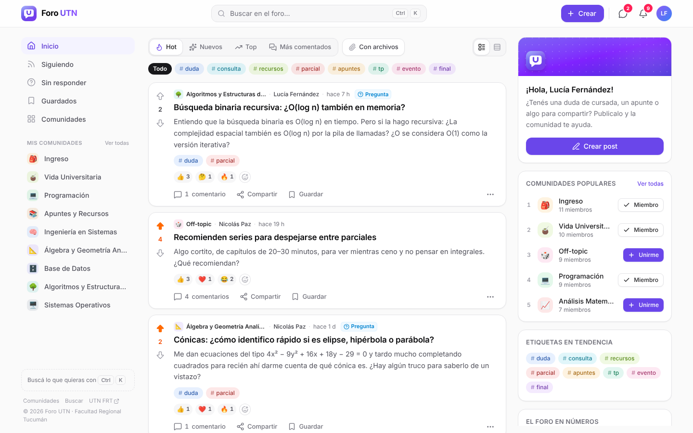
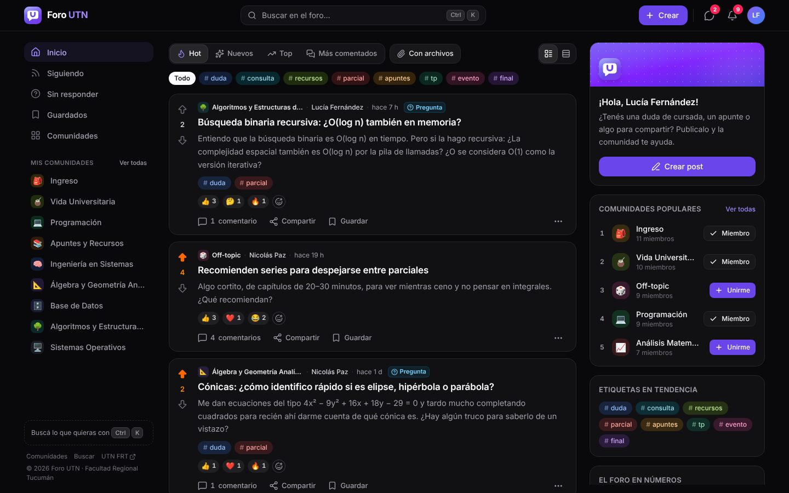
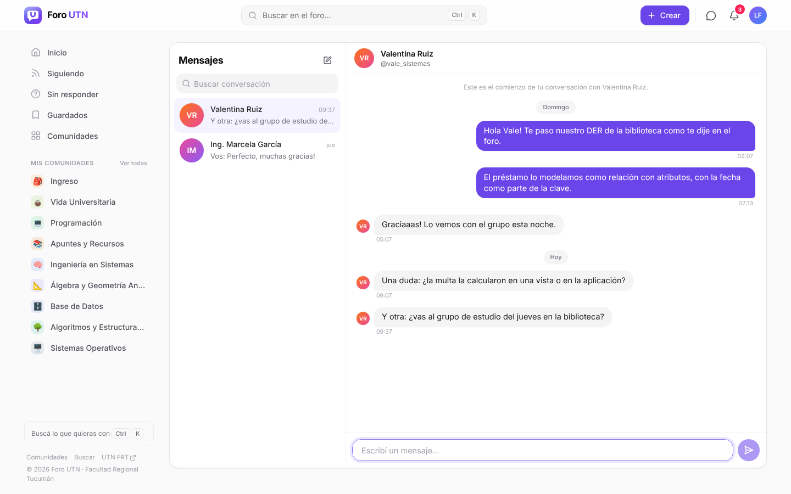
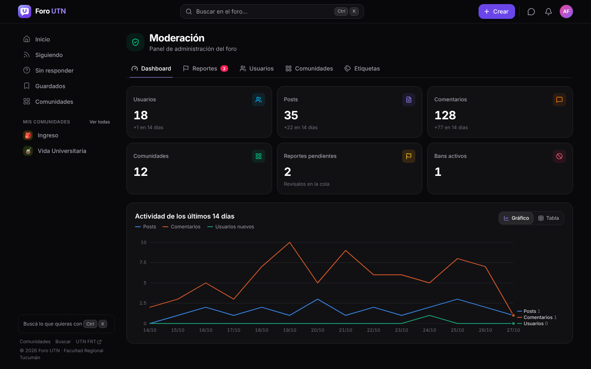
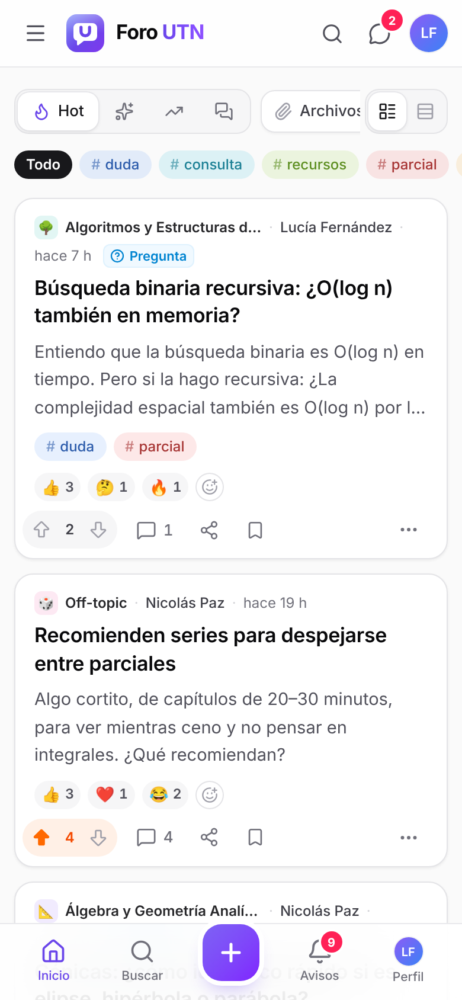

<div align="center">

# 🎓 Foro UTN — v2

**La comunidad de la UTN Facultad Regional Tucumán**
Consultas de parcial · apuntes · encuestas · mensajes · todo en un solo lugar

[](https://react.dev/)
[](https://vite.dev/)
[](https://tailwindcss.com/)
[](https://expressjs.com/)
[](https://www.prisma.io/)
[](https://www.typescriptlang.org/)

</div>

---

## 📸 Capturas

<div align="center">
  
  <br><br>
  
  
  <br><br>
  
  
  <br><br>
  
</div>

---

## ✨ Qué tiene

| Área | Funciones |
|------|-----------|
| **Comunidades** | Una por materia o tema, con ícono, color y reglas. Te unís y armás tu feed |
| **Posts** | Texto, **pregunta** (con respuesta aceptada ✓), **encuesta**, link. Markdown con vista previa, imágenes (pegar / arrastrar), etiquetas, editar y borrar |
| **Archivos adjuntos** | PDF, Word, Excel, PowerPoint, imágenes, zip y código en posts, comentarios y mensajes. Barra de progreso, vista previa de PDF e imágenes, filtro "Con archivos" |
| **Reacciones** | 👍 ❤️ 😂 😮 😢 🎉 🤔 🔥 en posts y comentarios, con "quién reaccionó" |
| **Borradores** | El post se guarda solo mientras lo escribís y lo seguís desde cualquier dispositivo |
| **Comentarios** | Hilos anidados que se colapsan, markdown, menciones `@usuario`, votos |
| **Feeds** | Hot · Nuevos · Top (día / semana / mes / año) · Más comentados · Siguiendo · Sin responder · Guardados. Scroll infinito, vista tarjeta o compacta |
| **Búsqueda** | Paleta de comandos con `Ctrl/⌘ + K`: posts, usuarios y comunidades |
| **Social** | Perfiles con karma, seguir usuarios, **mensajes directos en tiempo real** |
| **Notificaciones** | En vivo (SSE): respuestas, menciones, reacciones, seguidores, respuesta aceptada, moderación. **Avisos por mail** cuando no estás conectado, configurables |
| **Moderación** | Reportes, cola de moderación, bans temporales / permanentes, fijar y cerrar posts, roles `ADMIN` · `MODERATOR` · `PROFESSOR` · `STUDENT`, panel con métricas |
| **Cuenta** | Registro, login con email o usuario, **login con Google**, recuperar contraseña, cambiar contraseña (cierra otras sesiones), avatar, borrar cuenta |
| **App** | **Se instala en el celu o la compu** (PWA), funciona offline con una pantalla propia |
| **Diseño** | Claro / oscuro / sistema, responsive con barra inferior en el celu, skeletons, toasts, accesible por teclado |

---

## 🚀 Cómo usarlo

Necesitás **Node.js 20 o más nuevo**. Nada más: la base de datos es SQLite y se crea sola (no hace falta XAMPP ni MySQL).

```bash
git clone https://github.com/Fumacio/Proyecto-foro-universitario.git
cd Proyecto-foro-universitario

npm install        # instala el server y el front
npm run setup      # crea server/.env, la base y la llena con datos de ejemplo
npm run dev        # API en :3000 + front en http://localhost:5173
```

Abrí **http://localhost:5173** y entrá con cualquiera de estas cuentas (contraseña **`foro1234`**):

| Usuario | Rol |
|---------|-----|
| `admin` | Administrador |
| `moderadora` | Moderadora |
| `prof_garcia` | Profesor |
| `lucia_dev` · `tomi_ing` · `sofi_mate` · `nico_frt` · `vale_sistemas` | Estudiantes |

### Producción (un solo puerto)

```bash
npm run build      # compila el front en web/dist
NODE_ENV=production npm start   # el server sirve la API y el front en :3000
```

En producción `server/.env` tiene que tener un `JWT_SECRET` fuerte (el `setup` ya genera uno) y,
si corre detrás de un proxy, `TRUST_PROXY=1`.

### Otros comandos

| Comando | Qué hace |
|---------|----------|
| `npm test` | Tests de integración de la API (Vitest + Supertest) |
| `npm run db:reset` | Borra la base y vuelve a cargar los datos de ejemplo |
| `npm run make-admin -- usuario` | Le da rol de admin a un usuario (por username o email) |

### Variables de entorno (`server/.env`)

| Variable | Descripción |
|----------|-------------|
| `PORT` | Puerto del server (default `3000`) |
| `NODE_ENV` | `development` · `production` |
| `FRONTEND_URL` | URL del front, para los links de los emails (dev: `http://localhost:5173`) |
| `DATABASE_URL` | Default `file:./dev.db` (SQLite) |
| `JWT_SECRET` | Firma de las sesiones — largo, aleatorio y nunca a Git |
| `SMTP_*` | Opcional. Mails de recuperación, bienvenida y avisos. Sin SMTP se imprimen en la consola |
| `GOOGLE_CLIENT_ID` / `GOOGLE_CLIENT_SECRET` | Opcional. Activa "Continuar con Google" (ver abajo) |
| `MAX_UPLOAD_MB` | Opcional. Tamaño máximo por archivo adjunto (default `25`) |
| `TRUST_PROXY` | Opcional. `1` detrás de Render / Railway / Nginx |
| `COOKIE_SECURE` | Opcional. En producción la sesión exige HTTPS; poné `false` si lo servís por HTTP (red local) |

### Login con Google (opcional)

1. Entrá a [Google Cloud Console](https://console.cloud.google.com/apis/credentials) → **Crear credenciales** → **ID de cliente de OAuth** → tipo **Aplicación web**.
2. En **URIs de redireccionamiento autorizados** agregá `http://localhost:5173/api/auth/google/callback`
   (y en producción `https://tu-dominio/api/auth/google/callback`, o sea `FRONTEND_URL` + `/api/auth/google/callback`).
3. Copiá el ID y el secreto en `server/.env` como `GOOGLE_CLIENT_ID` y `GOOGLE_CLIENT_SECRET` y reiniciá. El botón aparece solo.

### Mails con Gmail (opcional)

Activá la verificación en dos pasos, creá una [contraseña de aplicación](https://myaccount.google.com/apppasswords) y poné en `server/.env`:
`SMTP_HOST=smtp.gmail.com`, `SMTP_PORT=587`, `SMTP_USER=tu@gmail.com`, `SMTP_PASS=<la contraseña de aplicación>`.

### Instalar como app

En producción (HTTPS) el navegador ofrece **Instalar**; también está en el menú de tu avatar. En iPhone: Compartir → *Agregar a inicio*.

**¿Postgres o MySQL?** Cambiá `provider` en `server/prisma/schema.prisma` y `DATABASE_URL`, y corré `npm run setup`.

---

## 🛠 Stack

| Capa | Tecnología |
|------|------------|
| Front | React 19 · Vite 7 · TypeScript · Tailwind CSS 4 · Radix UI · TanStack Query · React Router 7 · lucide |
| Back | Node · Express 5 · TypeScript (tsx) · Zod 4 |
| Base de datos | Prisma 6 · SQLite (cambiable a Postgres / MySQL) |
| Auth | JWT en cookie httpOnly + `tokenVersion` · bcrypt |
| Tiempo real | Server-Sent Events |
| Seguridad | helmet (CSP en prod) · rate limiting · validación en cada ruta · uploads verificados por contenido |
| Tests | Vitest · Supertest |

## 📁 Estructura

```
├── server/                 # API
│   ├── prisma/             # schema.prisma · seed.ts
│   ├── src/                # app · rutas · middleware · lib (auth, sse, notificaciones…)
│   ├── scripts/            # make-admin · ensure-env
│   └── tests/
├── web/                    # SPA React
│   └── src/                # páginas · componentes · hooks de datos
└── docs/
    ├── API.md              # contrato completo de la API
    └── PLAN.md             # plan de la reconstrucción
```

La documentación de todos los endpoints está en [`docs/API.md`](docs/API.md).

---

<div align="center">

Hecho con React · Express · Prisma · ❤ para la UTN FRT

</div>
